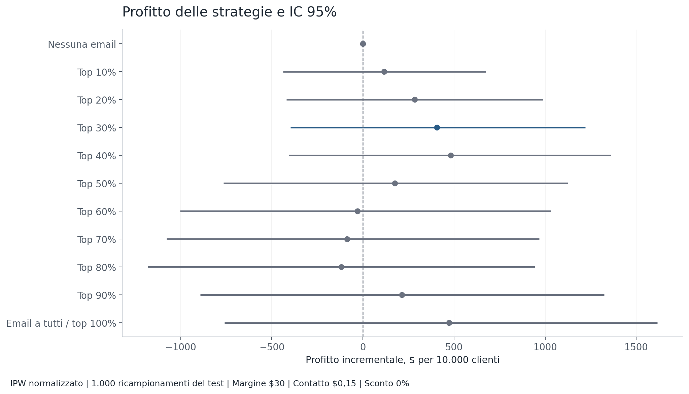
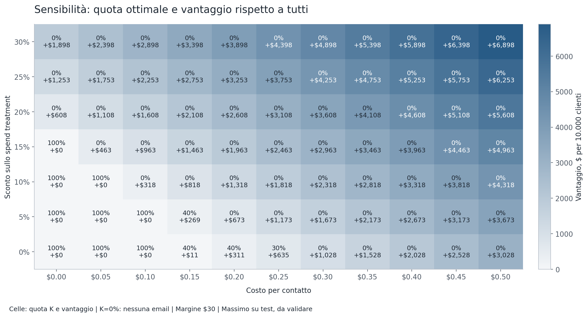
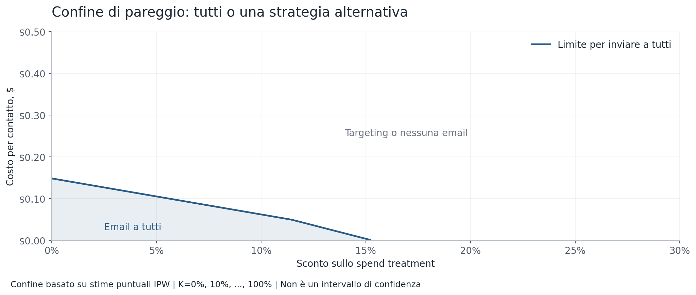
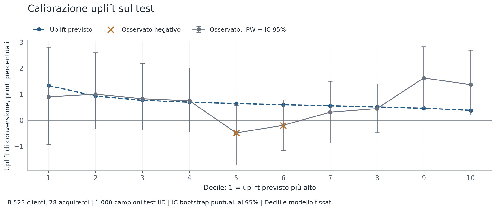
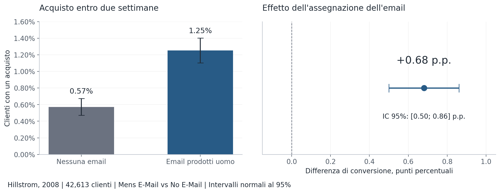
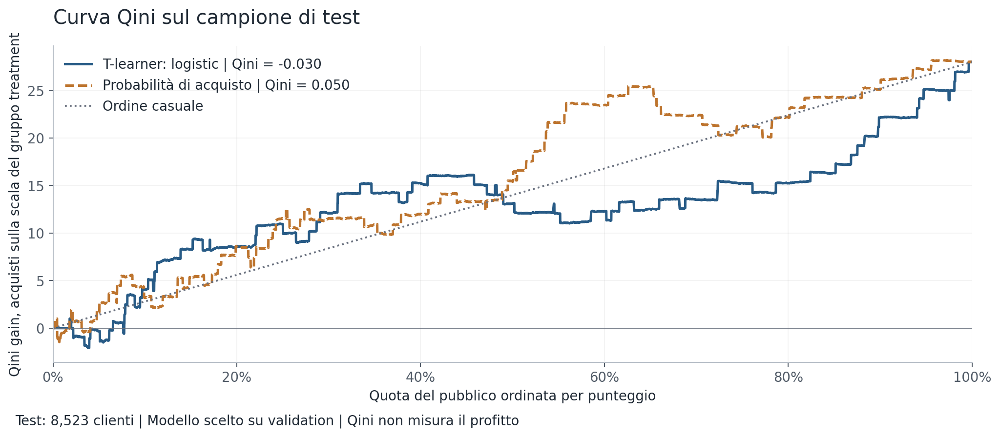
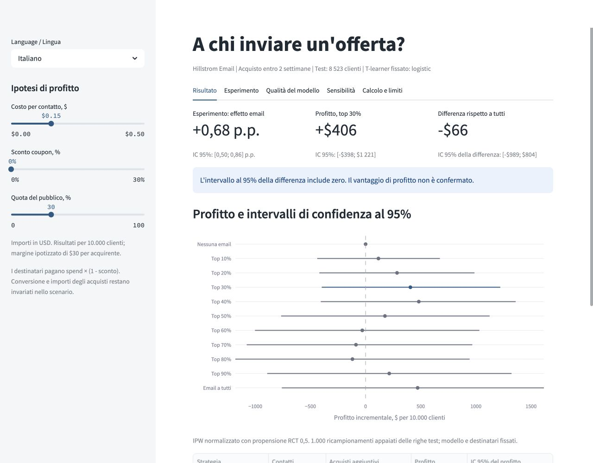

# Targeting email: uplift e profitto incrementale

[English](README.md) | **Italiano**

> **Risultato principale:** L'email aumenta la conversione di 0,68 p.p., IC 95% [0,50; 0,86].  
> Con \$0,15/contatto e coupon 0%, top-30% meno tutti è -\$66 per 10.000, IC 95% [-\$989; \$804], indistinguibile da zero.  
> La mia regola usa stime puntuali e richiede un nuovo test randomizzato prima dell'adozione.

Ho verificato se scegliere i clienti in base all'uplift rende una campagna email più redditizia. Ho mantenuto il modello iniziale ed esteso l'analisi economica con dati test randomizzati, costi dei coupon e incertezza.

## La decisione aziendale

**Problema.** Un modello di probabilità di acquisto identifica gli acquirenti probabili. Non identifica gli acquisti causati dal contatto. I coupon riducono il contributo anche sugli acquisti che avverrebbero comunque.

**Metrica.** Profitto contributivo incrementale rispetto a nessuna email, per 10.000 clienti. Ipotizzo **\$30 di contributo per acquirente prima del coupon, \$0,15 per contatto e coupon dello 0%**. Lo spend Hillstrom è in **USD**. Tutti gli importi sono in dollari; non applico conversioni valutarie o correzioni per inflazione.

**Risultato.** L'email aumenta la conversione di 0,68 punti percentuali, IC 95% [0,50; 0,86] p.p. La strategia top-30% fissata dà \$406 di profitto incrementale; l'invio a tutti dà \$472. La differenza appaiata è **-\$66**, IC 95% **[-\$989; \$804]**, statisticamente indistinguibile da zero. Questo non dimostra l'equivalenza delle strategie.

| Strategia | Contatti | Acquirenti aggiuntivi | Profitto per 10.000 | IC 95% del profitto |
|---|---:|---:|---:|---:|
| Nessuna email | 0 | 0.0 | \$0 | [\$0; \$0] |
| Email a tutti | 10,000 | 65.7 | \$472 | [-\$759; \$1,616] |
| Top 30% per uplift | 2,999 | 28.5 | \$406 | [-\$398; \$1,221] |
| Top 40% per uplift | 4,000 | 36.1 | \$482 | [-\$406; \$1,361] |

Il top 30% è la scelta iniziale su validation. Il top 40% è un massimo della sensibilità su test: il vantaggio stimato rispetto a tutti è solo \$11. Non lo considero una sostituzione validata. La selezione delle righe test arrotonda per difetto, quindi i contatti proiettati possono essere leggermente inferiori alla quota nominale.



**La mia regola per lo scenario:** “Inviare a tutti se lo sconto < 11,3% e il costo < \$0,05; altrimenti selezionare il top-K%.” Scelgo K tra 0%, 10%, ..., 100% con il calcolo di sensibilità; K=0% significa nessuna email. Questa regione conservativa è sufficiente per l'invio a tutti. Fuori dalla regione K può ancora essere 100%. La curva di pareggio mostra il confine esatto delle stime puntuali.

Con costo e sconto iniziali, K=40% massimizza il profitto stimato. **La regola decisionale usa stime puntuali, non limiti di confidenza.** Usa gli esiti test ed è una candidata per un nuovo esperimento randomizzato. Il top 30% iniziale non ha un vantaggio confermato rispetto a tutti: la differenza di -\$66, IC 95% [-\$989; \$804], è indistinguibile da zero.

## Sensibilità a costo e coupon

La griglia copre costo per contatto da \$0,00 a \$0,50 con passo \$0,05 e sconto da 0% a 30% con passo di 5 punti percentuali. Ognuna delle 77 celle riporta K ottimale, profitto e vantaggio rispetto a tutti. Includo nessuna email per poter evitare campagne in perdita. A parità di profitto scelgo il pubblico più piccolo.





Calcolo il profitto di ogni strategia fissata come `P_k = B_k - c × C_k - d × S_k`: B è il contributo prima di contatto e coupon, C i contatti, S lo spend treatment proiettato e d una frazione. Il confine per l'invio a tutti è:

```text
c_limit(d) = minimo per k < 100 di
            (B_100 - B_k - d × (S_100 - S_k)) / (C_100 - C_k)
```

L'invio a tutti massimizza le strategie candidate quando `0 <= c <= c_limit(d)`. Un limite negativo significa che non è mai migliore con costo non negativo. Senza coupon il limite è **\$0,14824 per contatto**. Con costo zero il limite dello sconto è **15,2868%**. Con costo \$0,05 è **11,3870%**; la regola breve arrotonda per difetto a 11,3%.

Il confine include nessuna email e non è un intervallo di confidenza. Il K migliore cambia con le ipotesi economiche. [Dati della griglia](reports/sensitivity_grid.csv) e [dati del confine](reports/break_even.csv) contengono i calcoli esatti.

## Valore della strategia sui dati randomizzati

Confronto Mens E-Mail con No E-Mail. Condizionando ai due gruppi randomizzati, la propensione treatment nota è 0,5. Uso **IPW normalizzato (Hajek)** nel pubblico selezionato e moltiplico l'effetto per la quota empirica del pubblico. Con propensione costante le medie ponderate coincidono con le medie osservate. Questo mantiene le stime puntuali iniziali senza sconto, anche con costo del contatto zero.

```text
N = 10.000; q = righe selezionate / righe test
w1 = treatment / 0,5; w0 = (1 - treatment) / 0,5
p1 = sum(w1 × conversion) / sum(w1) nelle righe selezionate
p0 = sum(w0 × conversion) / sum(w0) nelle righe selezionate
s1 = sum(w1 × spend) / sum(w1) nelle righe selezionate

Pagamento acquirente treatment = spend × (1 - d)
Profitto incrementale = N × q × [30 × (p1 - p0) - c - d × s1]
```

Mantengo l'ipotesi iniziale di contributo di \$30. Sottraggo l'intera riduzione dei ricavi dovuta al coupon, mantenendo fissi i costi degli acquisti. Non sostituisco il profitto con il fatturato. Il coupon si applica a ogni acquisto dei destinatari, inclusi quelli che avverrebbero senza email.

Il pubblico top-30% fissato contiene 1.272 clienti treatment con 23 acquirenti e 1.284 clienti control con 11 acquirenti:

```text
Contatti = 10.000 × 2.556 / 8.523 = 2.998,944
Contributo prima di contatto e coupon = $856,029
Spend treatment proiettato = $7.241,578
Profitto = $856,029 - 2.998,944 × c - $7.241,578 × d
Con c=$0,15, d=0%: profitto = $406,187
Con c=$0,15, d=10%: profitto = -$317,970
```

Le previsioni del modello ordinano solo i clienti. Le stime monetarie usano gli esiti randomizzati. Gli scenari coupon mantengono conversione e importi fissi: Hillstrom non randomizza lo sconto, quindi non ne stimo l'effetto sul comportamento.

## Bootstrap e tutte le quote

Estraggo **1.000 campioni bootstrap IID delle 8.523 righe test**, seed 42. Ogni campione è condiviso tra nessuna email, tutti e top-10%, ..., top-100%. Mantengo il modello e l'appartenenza alla strategia assegnata a ogni riga originale. Ricalcolo medie IPW e quota del pubblico nel campione. Gli intervalli sono i percentili 2,5 e 97,5.

L'intervallo top-30% meno tutti usa differenze appaiate nello stesso campione. Nessuna email ha profitto incrementale zero per definizione, con IC [\$0; \$0]. Top 100% coincide con tutti nella stima puntuale e in ogni ricampionamento.

Gli intervalli escludono l'incertezza dell'addestramento e non correggono la scelta del K migliore dopo aver visto gli esiti test. Descrivono strategie fissate. Per l'analisi estesa questo bootstrap IID sostituisce gli intervalli precedenti stratificati per gruppo con quota fissa; le stime puntuali senza coupon restano invariate.

[Stime e intervalli di tutte le strategie](reports/policy_profit.csv) | [Componenti bootstrap](reports/bootstrap_components.csv) | [Metadati](reports/profit_analysis.json)

## Calibrazione uplift

Divido l'ordine test fissato in dieci decili quasi uguali. Il decile 1 ha l'uplift previsto più alto. Confronto l'uplift di conversione medio previsto con quello osservato tramite IPW normalizzato. Mantengo tutte le righe test e risolvo i pareggi nell'ordine salvato. Le barre mostrano IC puntuali al 95% basati sui percentili di 1.000 ricampionamenti IID delle righe test, seed 42. Appartenenza ai decili e modello restano fissi; ricalcolo l'uplift osservato di ogni decile in ciascun campione.



**I decili centrali 5 e 6, non quelli in fondo, hanno uplift osservato negativo.** Il decile 5 è -0,499 p.p., IC 95% [-1,720; 0,558]; il decile 6 è -0,205 p.p., IC 95% [-1,168; 0,779]. Il grafico segnala le stime puntuali negative con croci. Entrambi gli intervalli includono zero. Il risultato indica un ordine inaffidabile con questa numerosità, non un segmento danneggiato identificato. Una stima negativa sosterrebbe un danno solo con un IC che esclude zero; questi intervalli puntuali non correggono inoltre il confronto di dieci decili.

Ogni decile contiene solo 852 o 853 clienti; tutto il test ha 78 acquirenti. Gli esiti rari limitano la precisione del bootstrap e gli intervalli escludono l'incertezza dell'addestramento. [Conteggi, indicatori e intervalli di calibrazione](reports/uplift_calibration.csv) rendono verificabile il confronto.

## Esperimento, modello e validazione

La fonte contiene 64.000 clienti. Il confronto binario ha 42.613 clienti: treatment 21.307 con 267 acquirenti; control 21.306 con 122. Escludo Womens E-Mail prima del modello. L'effetto medio usa intention to treat e IC normale al 95%. p-value dell'effetto 1,47e-13; p-value dello squilibrio numerico 0,996; massimo SMD assoluto 0,014.



Non ci sono date di osservazione, quindi uso una divisione 60/20/20, seed 42, stratificata per treatment × conversion. Train ha 25.567 clienti e 233 acquirenti; validation e test hanno ciascuno 8.523 clienti e 78 acquirenti. Per campagne con date dividerei per tempo mantenendo ogni cliente in un solo campione.

I predittori sono recency, log della storia acquisti, acquisti uomo e donna precedenti, indicatore nuovo cliente, tipo di zona e canale. Esiti e assegnazione sono esclusi; il preprocessing usa train. I T-learner logistic e forest hanno classificatori separati treatment/control. L'ordine per probabilità di acquisto è la baseline del modello; nessuna email e tutti sono baseline aziendali.

Mantengo logistic scelto tramite Qini validation e la quota iniziale del 30% scelta tramite profitto validation. Parametri, modello salvato e punteggi sono invariati. Qini logistic è 0,0946 su validation e -0,0301 su test; forest ha -0,0509 su test; la baseline della probabilità di acquisto raggiunge 0,0498. La sensibilità non cambia questa scelta.



## Avvio del progetto

Python 3.12. Dati, modello fissato, previsioni e report sono inclusi.

```bash
python3.12 -m venv .venv
source .venv/bin/activate
pip install -r requirements.txt
streamlit run app.py
```

La barra laterale inglese/italiana ha slider per costo e percentuale coupon. La demo aggiorna intervalli e differenze appaiate, mostra sensibilità e calibrazione e scarica la tabella delle strategie.



Ricalcolo l'analisi estesa **senza addestrare o modificare il modello**:

```bash
python scripts/extend_profit.py
pytest -q
```

`python scripts/run_analysis.py` esegue il training iniziale completo e poi l'estensione. I notebook eseguiti [inglese](notebooks/analysis.ipynb) e [italiano](notebooks/analysis_it.ipynb) spiegano l'analisi del modello fissato. Gli HTML sono [English](reports/analysis.html) e [Italiano](reports/analysis_it.html).

I test coprono identità delle strategie 0% e 100%, mantenimento del profitto iniziale con costo e coupon zero, aritmetica percentuale, bootstrap appaiato, confine di sensibilità, copertura dei decili e intervalli bootstrap, leakage, divisioni e slider bilingui. I metadati salvano le impronte SHA-256 del modello e del suo codice invariati.

## Limiti

È un esperimento email con acquisto entro due settimane. Non dimostra risposta agli sconti, retention o profitto di lungo periodo. Contributo e costo contatto sono ipotesi; resi, costi fissi, disiscrizioni e margini individuali non sono disponibili. La proiezione assume stessa popolazione ed effetto. Mantengo profili identici perché mancano ID cliente; gli ID riga non permettono di verificare l'indipendenza.

La mia regola è una candidata economica esplorativa. Fisserei K e ipotesi coupon, calcolerei la numerosità per una differenza di profitto rilevante ed eseguirei un nuovo confronto randomizzato con tutti e nessuna email. Userei come metrica primaria il contributo reale dopo i resi.

## Prossimi passi

Previsti, non implementati in questo progetto:

- Eseguire un test randomizzato più ampio o più lungo per raccogliere più acquisti. Fisserei finestra dell'esito e numerosità prima del lancio.
- Valutare `visit` come esito surrogato esplorativo con una frequenza di base molto più alta: 14,45% per le visite contro 0,92% per gli acquisti su questo test. Verificherei il legame con acquisti e profitto prima di usarlo nelle decisioni; più visite da sole non dimostrano un profitto.
- Confrontare un DR-learner con il T-learner attuale usando cross-fitting e un nuovo holdout, con la stessa valutazione del valore della strategia e del profitto.

Fonte: [documentazione Hillstrom](https://www.uplift-modeling.com/en/latest/api/datasets/fetch_hillstrom.html). Metodo: [ponderazione per propensione inversa in EconML](https://www.pywhy.org/EconML/spec/estimation/dr.html). Il checksum della fonte è in `reports/summary.json`.
