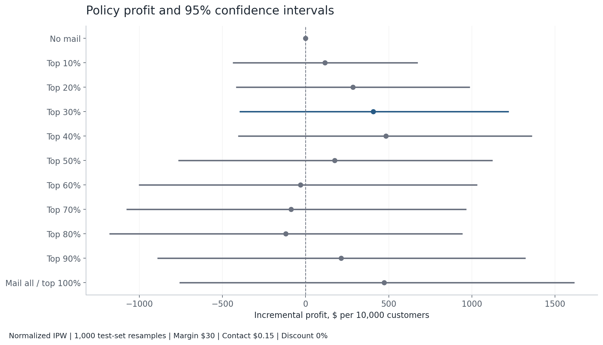
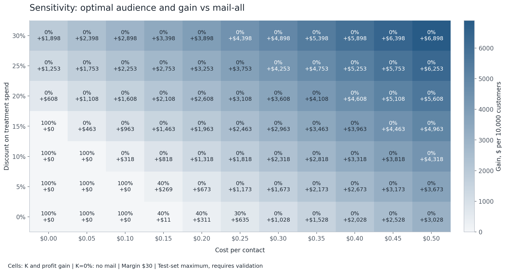
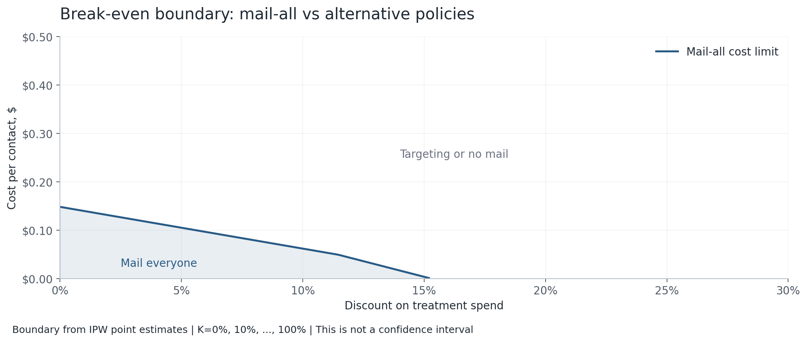
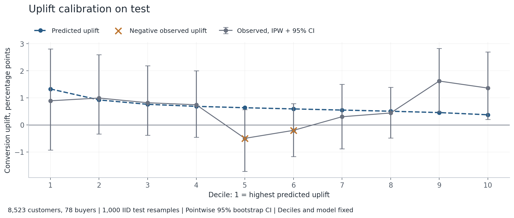
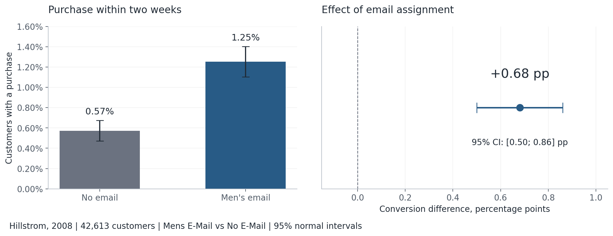
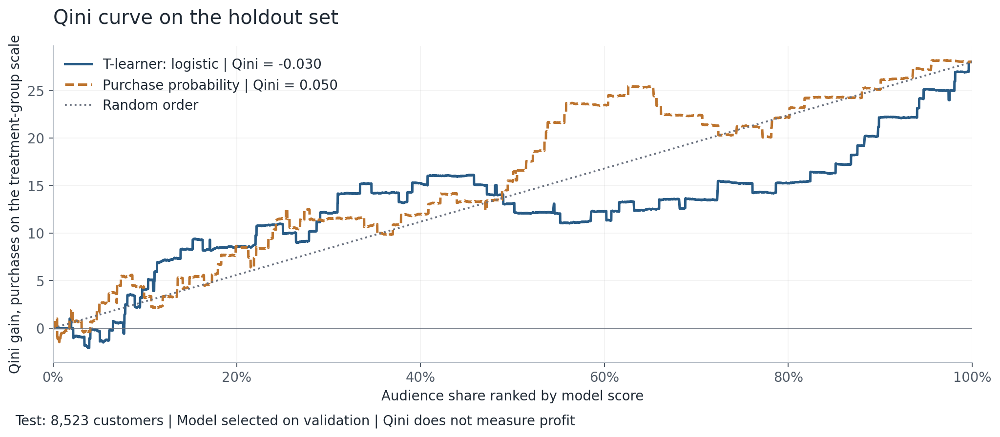
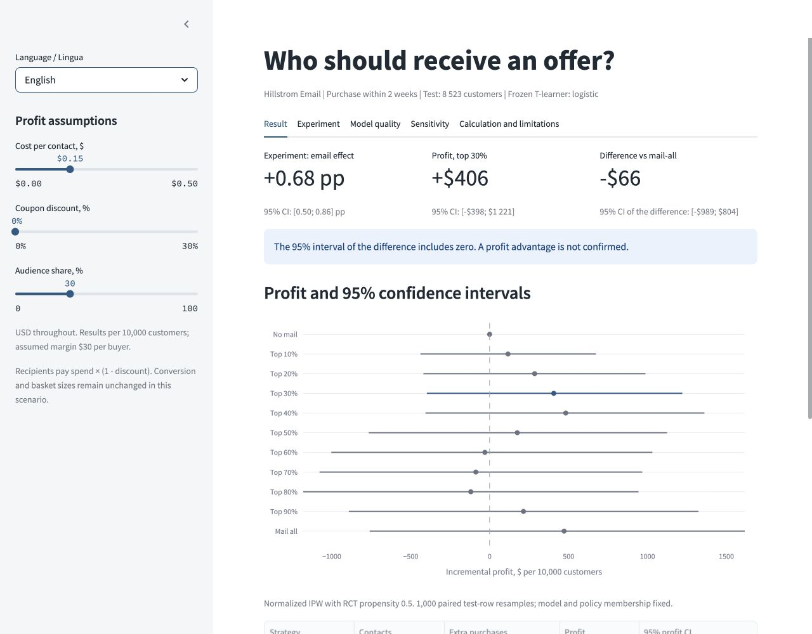

# Email targeting: uplift and incremental profit

**English** | [Italiano](README.it.md)

Live app: [Email campaign uplift](https://gr1gorii-discount-uplift.streamlit.app/)

> **Key result:** Email lifts conversion by 0.68 pp, 95% CI [0.50; 0.86].  
> At \$0.15/contact and 0% coupon, top-30% minus mail-all is -\$66 per 10,000, 95% CI [-\$989; \$804], indistinguishable from zero.  
> My decision rule uses point estimates and needs a new randomized test before rollout.

I tested whether selecting customers by uplift makes an email campaign more profitable. I kept the original model and expanded the economic analysis using randomized test data, coupon costs and uncertainty.

## The business decision

**Problem.** A purchase-probability model identifies likely buyers. It does not identify purchases caused by contact. Coupons also reduce contribution on purchases that would happen anyway.

**Metric.** Incremental contribution profit relative to no mail, per 10,000 customers. I assume **\$30 contribution per buyer before coupon, \$0.15 per contact and a 0% coupon**. Hillstrom spend is in **USD**. All monetary values use dollars; I apply no currency conversion or inflation adjustment.

**Result.** Email increases conversion by 0.68 percentage points, 95% CI [0.50; 0.86] pp. The frozen top-30% policy gives \$406 incremental profit; mail-all gives \$472. Their paired difference is **-\$66**, 95% CI **[-\$989; \$804]**, statistically indistinguishable from zero. This does not establish that the policies are equivalent.

| Policy | Contacts | Extra buyers | Profit per 10,000 | 95% profit CI |
|---|---:|---:|---:|---:|
| No mail | 0 | 0.0 | \$0 | [\$0; \$0] |
| Mail all | 10,000 | 65.7 | \$472 | [-\$759; \$1,616] |
| Top 30% by uplift | 2,999 | 28.5 | \$406 | [-\$398; \$1,221] |
| Top 40% by uplift | 4,000 | 36.1 | \$482 | [-\$406; \$1,361] |

Top 30% is the original validation choice. Top 40% is a test-set sensitivity maximum: its estimated gain over mail-all is only \$11. I do not treat it as a validated replacement. Contacts are rounded down when selecting test rows, so projected counts can be slightly below the nominal campaign share.



**My scenario decision rule:** “Mail everyone if discount < 11.3% and cost < \$0.05; otherwise target top-K%.” I choose K from 0%, 10%, ..., 100% using the sensitivity calculation; K=0% means no mail. This is a conservative sufficient region for mail-all. Outside it, K can still be 100%. The full break-even curve gives the exact point-estimate boundary.

At the default cost and discount, K=40% maximizes estimated profit. **The decision rule uses point estimates, not confidence bounds.** It uses test outcomes and is a candidate for a new randomized pilot. The original top-30% policy has no confirmed advantage over mail-all: its -\$66 difference, 95% CI [-\$989; \$804], is indistinguishable from zero.

## Contact cost and coupon sensitivity

The grid covers contact cost \$0.00 to \$0.50 in \$0.05 steps and coupon discount 0% to 30% in 5 percentage point steps. Each of 77 cells reports optimal K, profit and gain versus mail-all. No mail is included so the calculation can choose not to run a loss-making campaign. Ties favor the smaller audience.





I compute profit for each fixed policy as `P_k = B_k - c × C_k - d × S_k`, where B is contribution before contact and coupon, C is contacts, S is projected treatment spend, and d is a fraction. The mail-all boundary is:

```text
c_limit(d) = min over k < 100 of
            (B_100 - B_k - d × (S_100 - S_k)) / (C_100 - C_k)
```

Mail-all maximizes the candidate policies when `0 <= c <= c_limit(d)`. A negative limit means mail-all is never best at nonnegative cost. With no coupon the limit is **\$0.14824 per contact**. At zero contact cost the coupon limit is **15.2868%**. With contact cost \$0.05, the coupon limit is **11.3870%**; the short rule rounds down to 11.3%.

The boundary includes no mail and is not a confidence interval. The best K changes with economics. [Grid data](reports/sensitivity_grid.csv) and [boundary data](reports/break_even.csv) contain the exact calculations.

## Policy value on randomized data

I compare Mens E-Mail with No E-Mail. Conditional on these two randomized arms, the known treatment propensity is 0.5. I use **normalized IPW (Hajek)** within each selected audience and multiply its effect by the empirical audience share. With constant propensity the weighted arm means equal observed arm means. This preserves the existing point estimates at zero discount, including when contact cost is zero.

```text
N = 10,000; q = selected rows / test rows
w1 = treatment / 0.5; w0 = (1 - treatment) / 0.5
p1 = sum(w1 × conversion) / sum(w1) within selected rows
p0 = sum(w0 × conversion) / sum(w0) within selected rows
s1 = sum(w1 × spend) / sum(w1) within selected rows

Treated buyer payment = spend × (1 - d)
Incremental profit = N × q × [30 × (p1 - p0) - c - d × s1]
```

The \$30 contribution assumption is retained from the original simulation. I subtract the coupon's full revenue reduction from that contribution while holding purchase costs fixed. I do not substitute sales revenue for profit. The coupon applies to every recipient purchase, including purchases that would occur without email.

For the frozen top-30% audience there are 1,272 treatment customers with 23 buyers and 1,284 control customers with 11 buyers:

```text
Contacts = 10,000 × 2,556 / 8,523 = 2,998.944
Contribution before contact and coupon = $856.029
Projected treatment spend = $7,241.578
Profit = $856.029 - 2,998.944 × c - $7,241.578 × d
At c=$0.15, d=0%: profit = $406.187
At c=$0.15, d=10%: profit = -$317.970
```

Model predictions only rank customers. Monetary estimates use randomized outcomes. Coupon scenarios hold conversion and basket amounts fixed: Hillstrom did not randomize coupon size, so these calculations do not estimate its behavioral effect.

## Bootstrap and all audience shares

I draw **1,000 IID bootstrap samples of all 8,523 test rows**, seed 42. Each draw is shared across no mail, mail-all and top-10%, ..., top-100%. I retain the fitted model and the policy membership assigned to each original row. I recalculate IPW means and audience share on the resampled rows. Intervals are the 2.5th and 97.5th percentiles.

The top-30% minus mail-all interval uses paired differences within each draw. No mail has incremental profit zero by definition, with CI [\$0; \$0]. Top 100% equals mail-all in both point estimate and every resample.

These intervals exclude training uncertainty and do not correct for choosing a best K after inspecting test outcomes. They describe fixed policies. This IID bootstrap replaces the older treatment-stratified, fixed-share intervals for the extended analysis; point estimates are unchanged at zero coupon.

[All policy estimates and intervals](reports/policy_profit.csv) | [Bootstrap components](reports/bootstrap_components.csv) | [Analysis metadata](reports/profit_analysis.json)

## Uplift calibration

I divide the frozen test ranking into ten nearly equal deciles. Decile 1 has the highest predicted uplift. I compare mean predicted conversion uplift with normalized-IPW observed conversion uplift in each decile. I keep all test rows and resolve score ties in saved row order. The bars show pointwise 95% percentile intervals from 1,000 IID bootstrap samples of the test rows, seed 42. Decile membership and the model stay fixed; I recalculate each decile's observed uplift within each draw.



**Middle deciles 5 and 6, not the bottom deciles, have negative observed uplift.** Decile 5 is -0.499 pp, 95% CI [-1.720; 0.558]; decile 6 is -0.205 pp, 95% CI [-1.168; 0.779]. The plot marks negative point estimates with crosses. Both intervals include zero. This pattern indicates unreliable ranking at this sample size, not an identified harmed segment. A negative estimate would only support harm if its CI excluded zero; these pointwise intervals also do not adjust for testing ten deciles.

Each decile contains only 852 or 853 customers; the whole test has 78 buyers. Sparse outcomes limit bootstrap precision, and these intervals exclude model-training uncertainty. [Counts, flags and calibration intervals](reports/uplift_calibration.csv) make the comparison inspectable.

## Experiment, model and validation

The source contains 64,000 customers. My binary comparison has 42,613: treatment 21,307 with 267 buyers; control 21,306 with 122 buyers. I exclude Womens E-Mail before modeling. The average effect uses intention to treat and a normal 95% interval. Effect p-value is 1.47e-13; sample ratio mismatch p-value is 0.996; maximum absolute feature SMD is 0.014.



There are no observation dates, so I use a 60/20/20 split, seed 42, stratified by treatment × conversion. Train contains 25,567 customers and 233 buyers; validation and test each contain 8,523 customers and 78 buyers. For dated campaigns I would split by time and keep customers in one split.

Features are pre-contact recency, log purchase history, prior men's and women's purchases, new-customer flag, area type and channel. Outcomes and assignment are excluded; preprocessing is fitted on train. Logistic and forest T-learners use separate treatment/control classifiers. Purchase-probability ranking is the model baseline; no mail and mail-all are business baselines.

I retain logistic, selected by validation Qini, and the original 30% share selected by validation profit. Model parameters, saved model and saved scores are unchanged. Logistic Qini is 0.0946 on validation and -0.0301 on test; forest test Qini is -0.0509; the purchase-probability baseline reaches 0.0498. Sensitivity does not change that selection.



## Run the project

Python 3.12. Data, frozen model, predictions and reports are included.

```bash
python3.12 -m venv .venv
source .venv/bin/activate
pip install -r requirements.txt
streamlit run app.py
```

The English/Italian sidebar has sliders for contact cost and coupon percentage. The demo updates all policy intervals and paired differences, shows sensitivity and calibration, and downloads a policy table.



Recalculate the extended analysis **without fitting or modifying the model**:

```bash
python scripts/extend_profit.py
pytest -q
```

`python scripts/run_analysis.py` runs the original full training pipeline and then the extension. The executed [English notebook](notebooks/analysis.ipynb) and [Italian notebook](notebooks/analysis_it.ipynb) explain the frozen-model analysis. Their HTML exports are [English](reports/analysis.html) and [Italiano](reports/analysis_it.html).

Tests cover policy identities at 0% and 100%, preservation of the original zero-cost/zero-coupon profit, percentage-coupon arithmetic, paired row bootstrap, the sensitivity boundary, decile coverage and bootstrap intervals, leakage, splits and bilingual sliders. SHA-256 fingerprints of the unchanged model and model code are stored in analysis metadata.

## Limitations

This is an email experiment with a two-week purchase outcome. It cannot establish discount response, retention or lifetime profit. Contribution and contact costs are assumptions; returns, fixed costs, unsubscribes and customer-level margins are unavailable. Scaling assumes the same population and treatment effect. I retain identical profiles because no customer IDs exist; independence cannot be checked from row IDs alone.

My decision rule is an exploratory economic candidate. I would freeze K and coupon assumptions, calculate the sample size for a meaningful profit difference, and run a fresh randomized comparison against mail-all and no mail. I would then use actual contribution after returns as the primary metric.

## Next steps

Planned, not implemented in this project:

- Run a larger or longer randomized test to collect more purchases. I would set the outcome window and sample size before launch.
- Evaluate `visit` as an exploratory surrogate outcome with a much higher base rate: 14.45% for visits versus 0.92% for purchases on this test set. I would check its relationship to purchases and profit before using it for decisions; more visits alone do not establish profit.
- Compare a DR-learner with the current T-learner using cross-fitting and a fresh holdout, with the same policy-value and profit evaluation.

Source: [Hillstrom dataset documentation](https://www.uplift-modeling.com/en/latest/api/datasets/fetch_hillstrom.html). Method reference: [inverse-propensity outcome weighting in EconML](https://www.pywhy.org/EconML/spec/estimation/dr.html). Raw file checksum is in `reports/summary.json`.

## Project code license

Copyright (c) 2026 Gr1gorii.

The original project code authored by Gr1gorii is licensed under the
GNU General Public License version 3 only (`GPL-3.0-only`).
See [LICENSE](LICENSE) for the full terms.

Third-party code, datasets, and materials retain their respective licenses
and attribution requirements. This license does not replace those terms.
